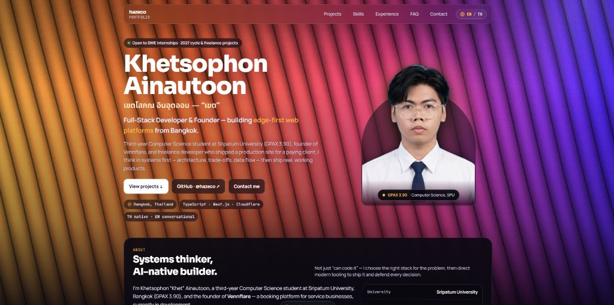

# 🌐 hazeco — Personal Developer Portfolio

<div align="center">



**Khetsophon Ainautoon (hazeco)**  
*Full-Stack Developer & Systems Thinker — Bangkok, Thailand*

[](https://hazeco.dev)
[](https://astro.build)
[](https://tailwindcss.com)
[](https://www.typescriptlang.org/)

[English](#-english) • [ภาษาไทย](#-ภาษาไทย)

</div>

---

## 🇬🇧 English

A high-performance, responsive, and bilingual portfolio built with **Astro 5** and **Tailwind CSS v4**. Featuring interactive WebGL shader blinds background, dynamic SPA transitions, live link previews, and client-side bilingual (EN / TH) switching with zero page flash.

### ✨ Highlights

* **WebGL Live Gradient Blinds**: Interactive, fluid shader canvas background adapted from React Bits, persisted across view changes via Astro `<ClientRouter />`.
* **Zero-Flash Bilingual Support (EN / TH)**: Client-side language switcher with localStorage persistence and instant rendering without layout shift.
* **Responsive Architecture**:
  * **Desktop (≥ 1024px)**: Continuous single-page scroll with smooth navigation.
  * **Mobile & Tablet (< 1024px)**: Single-section view transitions controlled by header drawer navigation.
* **Smart Link Previews**: Desktop hover preview cards with real-time website snapshots and open-graph metadata for external links.
* **Modern Developer Stack Showcase**: Animated logo carousel supporting both `skillicons.dev` and `devicons.io` icons.
* **Live Bangkok Clock**: Real-time UTC+7 seconds ticker on the contact section.
* **One-Click Contact Copy & LINE QR**: Instant copy-to-clipboard buttons and downloadable LINE QR code.

### 🛠️ Tech Stack

* **Framework**: [Astro 5](https://astro.build/) (Static Site Generation)
* **Styling**: [Tailwind CSS v4](https://tailwindcss.com/)
* **Shader & Graphics**: WebGL Shader Canvas
* **Icons & Assets**: [Skill Icons](https://skillicons.dev), [Devicons](https://devicons.io), Custom SVGs

### 🚀 Getting Started

#### Prerequisites
* Node.js 18+ or 20+
* npm, pnpm, or bun

#### Installation
```bash
# Clone the repository
git clone https://github.com/hazeco/portfolio.git

# Navigate to directory
cd portfolio

# Install dependencies
npm install

# Start local development server
npm run dev
```

Visit `http://localhost:4321` in your browser.

#### Building for Production
```bash
npm run build
```
The output will be placed in the `dist/` directory, ready for deployment to Cloudflare Pages, Vercel, Netlify, or any static host.

---

## 🇹🇭 ภาษาไทย

แฟ้มผลงานส่วนตัว (Portfolio) ประสิทธิภาพสูง รองรับสองภาษา (ไทย / อังกฤษ) และแสดงผลได้อย่างสมบูรณ์แบบบนทุกขนาดหน้าจอ พัฒนาด้วย **Astro 5** และ **Tailwind CSS v4** มาพร้อมพื้นหลัง WebGL Shader แบบ Interactive, ระบบเปลี่ยนมุมมองหน้าเว็บแบบ SPA, การ์ดพรีวิวลิงก์ และการสลับภาษาแบบทันทีโดยไม่กระตุก

### ✨ จุดเด่นของโปรเจกต์

* **พื้นหลัง WebGL Gradient Blinds**: พื้นหลังแคนวาสแบบ Interactive ที่เรนเดอร์ด้วย Shader ปรับมุมมองตามการเคลื่อนไหว เชื่อมต่อตลอดการเปลี่ยนหน้าด้วย Astro `<ClientRouter />`
* **ระบบ 2 ภาษา (ไทย / อังกฤษ) ไร้รอยต่อ**: สลับภาษาได้ทันทีผ่าน Client-side พร้อมบันทึกลง `localStorage` โหลดหน้าใหม่ได้โดยไม่กะพริบ
* **การออกแบบตามขนาดหน้าจอ (Responsive)**:
  * **จอคอมพิวเตอร์ (Desktop ≥ 1024px)**: เลื่อนดูเนื้อหาแบบ Single-page ต่อเนื่อง พร้อมระบบ Smooth Scroll
  * **มือถือและแท็บเล็ต (< 1024px)**: แสดงผลทีละหมวดหมู่ตามแถบเมนู (Multi-view navigation) ช่วยให้อ่านง่ายไม่ล้นจอ
* **การ์ดพรีวิวเว็บไซต์ (Link Preview)**: แสดงภาพตัวอย่างหน้าเว็บจริงเมื่อนำเมาส์ไปชี้ที่ลิงก์ภายนอก
* **คลังเครื่องมือและเทคโนโลยี (Logo Cloud & Skills)**: แสดงทักษะจริงแบ่งตามหมวดหมู่ พร้อมรองรับทั้งไอคอนจาก `skillicons.dev` และ `devicons.io`
* **นาฬิกาเวลาจริงกรุงเทพฯ (Live Bangkok Clock)**: แสดงเวลานับวินาทีแบบเรียลไทม์ (UTC+7) ในส่วนติดต่อ
* **ปุ่มคัดลอกข้อมูล & ดาวน์โหลด QR Code LINE**: ปุ่มกดคัดลอกอีเมล/ไอดีลงคลิปบอร์ดได้ในคลิกเดียว พร้อมปุ่มดาวน์โหลดรูป QR Code

### 🛠️ เทคโนโลยีที่ใช้

* **เฟรมเวิร์ก**: [Astro 5](https://astro.build/) (Static Site Generation)
* **การจัดสไตล์**: [Tailwind CSS v4](https://tailwindcss.com/)
* **กราฟิกและลูกเล่น**: WebGL Shader Canvas
* **ไอคอน**: [Skill Icons](https://skillicons.dev), [Devicons](https://devicons.io), Custom SVGs

### 🚀 วิธีการติดตั้งและรันโปรเจกต์

#### สิ่งที่ต้องเตรียม
* Node.js เวอร์ชัน 18+ หรือ 20+
* ตัวจัดการแพ็กเกจ เช่น npm, pnpm หรือ bun

#### ขั้นตอนการรันบนเครื่อง (Local)
```bash
# โคลนโปรเจกต์
git clone https://github.com/hazeco/portfolio.git

# เข้าสู่โฟลเดอร์โปรเจกต์
cd portfolio

# ติดตั้ง Dependencies
npm install

# รัน Dev Server
npm run dev
```

เปิดดูหน้าเว็บได้ที่ `http://localhost:4321` บนเบราว์เซอร์

#### บิลด์สำหรับนำขึ้น Production
```bash
npm run build
```
ไฟล์พร้อมเผยแพร่จะถูกสร้างไว้ในโฟลเดอร์ `dist/` สามารถนำไปติดตั้งบน Cloudflare Pages, Vercel, Netlify หรือ Static Hosting ใดก็ได้ทันที

---

<div align="center">

© 2026 **Khetsophon Ainautoon (hazeco)**. All rights reserved.

</div>
